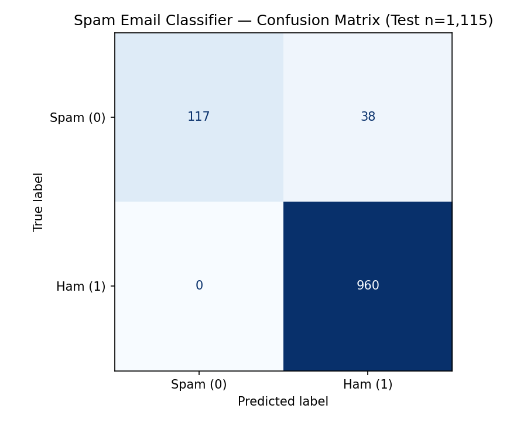

# Spam Email Detection Model

Supervised NLP binary text classifier that detects spam vs. legitimate (ham) messages across **5,572 labeled records** using **TF-IDF vectorization** and **Logistic Regression**.

---

## Overview

Unsolicited spam and phishing messages degrade inbox signal and expose users to security risks. This project builds an end-to-end Scikit-learn classification pipeline covering null handling, label encoding, TF-IDF feature extraction, evaluation beyond raw accuracy (Precision, Recall, F1, Confusion Matrix), automated unit tests, and CLI inference.

---

## Key Features

- **Reproducible Pipeline:** Modular Python script ([`spam_classifier.py`](spam_classifier.py)) alongside the exploratory Jupyter Notebook ([`Spam E-mail Detection.ipynb`](Spam%20E-mail%20Detection.ipynb)).
- **TF-IDF Text Vectorization:** Removes English stop words, normalizes casing, and extracts term-frequency inverse-document-frequency features.
- **Full Classification Diagnostics:** Reports accuracy, per-class Precision/Recall/F1, and exports a confusion matrix plot ([`assets/confusion_matrix.png`](assets/confusion_matrix.png)).
- **CLI Inference & Automated Tests:** Classify custom text from the terminal and verify pipeline invariants with `unittest` + GitHub Actions CI.

---

## Technology Stack

- **Language:** Python 3.9+
- **Libraries:** Pandas, NumPy, Scikit-learn (`TfidfVectorizer`, `LogisticRegression`), Matplotlib
- **Testing & CI:** Python `unittest`, GitHub Actions

---

## Dataset Summary

- **File:** `mail_data.csv`
- **Total Records:** `5,572` rows (`4,457` train / `1,115` test via `80/20` split, `random_state=3`)
- **Labels:** `spam` → `0`, `ham` → `1`

---

## Verified Model Performance

Evaluated on the held-out test set (`n = 1,115` messages):

| Metric | Value | Notes |
| :--- | :---: | :--- |
| **Training Accuracy** | **96.70%** *(96.77% in original Colab notebook)* | Consistent fit without severe overfitting |
| **Test Accuracy** | **96.59%** *(96.68% in original Colab notebook)* | Evaluated across `1,115` unseen messages |
| **Spam Precision (`0`)** | **1.00** | `0` false positives (no legitimate emails flagged as spam) |
| **Spam Recall (`0`)** | **0.75** | `117 / 155` spam samples caught cleanly (`38` false negatives) |
| **Ham Precision / Recall (`1`)** | **0.96 / 1.00** | `960 / 960` ham emails correctly preserved |

### Confusion Matrix



---

## Project Structure

```text
Spam-Email-Detection-Model/
├── .github/workflows/ci.yml      # Automated test workflow
├── assets/
│   └── confusion_matrix.png      # Generated evaluation confusion matrix
├── tests/
│   └── test_classifier.py        # Unit tests for dataset, accuracy & predictions
├── mail_data.csv                 # Labeled message dataset (5,572 rows)
├── Spam E-mail Detection.ipynb   # Original exploratory notebook
├── spam_classifier.py            # Reproducible training, evaluation & CLI script
├── requirements.txt              # Pinned Python dependencies
├── LICENSE                       # MIT License
└── README.md
```

---

## Installation & Usage

```bash
git clone https://github.com/yogesh-patil2003/Spam-Email-Detection-Model.git
cd Spam-Email-Detection-Model
pip install -r requirements.txt
```

### Train, Evaluate & Generate Metrics

```bash
python spam_classifier.py
```

### Classify a Custom Message via CLI

```bash
python spam_classifier.py --text "Congratulations! Claim your free voucher now."
```

---

## Testing

Run the automated `unittest` suite locally:

```bash
python -m unittest discover -s tests -v
```

*(Verified locally: 3/3 tests passing covering dataset integrity, >96% accuracy threshold, and spam/ham inference.)*

---

## Roadmap

- Compare Logistic Regression against Multinomial Naive Bayes, LinearSVC, and `class_weight="balanced"` to improve spam recall above `0.75` while preserving high precision.
- Serialize trained `Pipeline(TfidfVectorizer, LogisticRegression)` artifacts via `joblib` for API serving.

---

## License

MIT License — see [LICENSE](LICENSE).

## Author

**Yogesh Patil** — [@yogesh-patil2003](https://github.com/yogesh-patil2003) · [LinkedIn](https://www.linkedin.com/in/yogeshpatil2003/) · [Email](mailto:officialyogeshpatil0@gmail.com)
